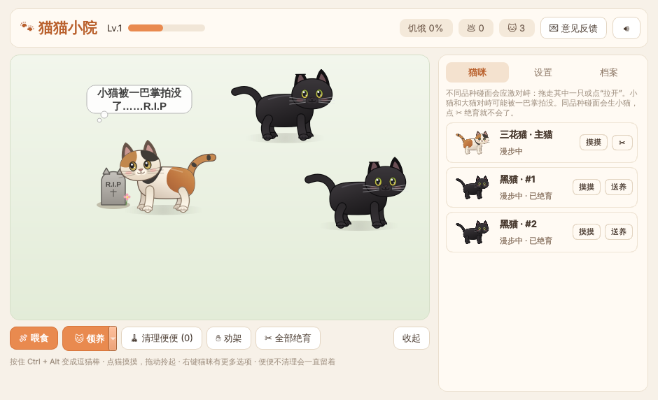
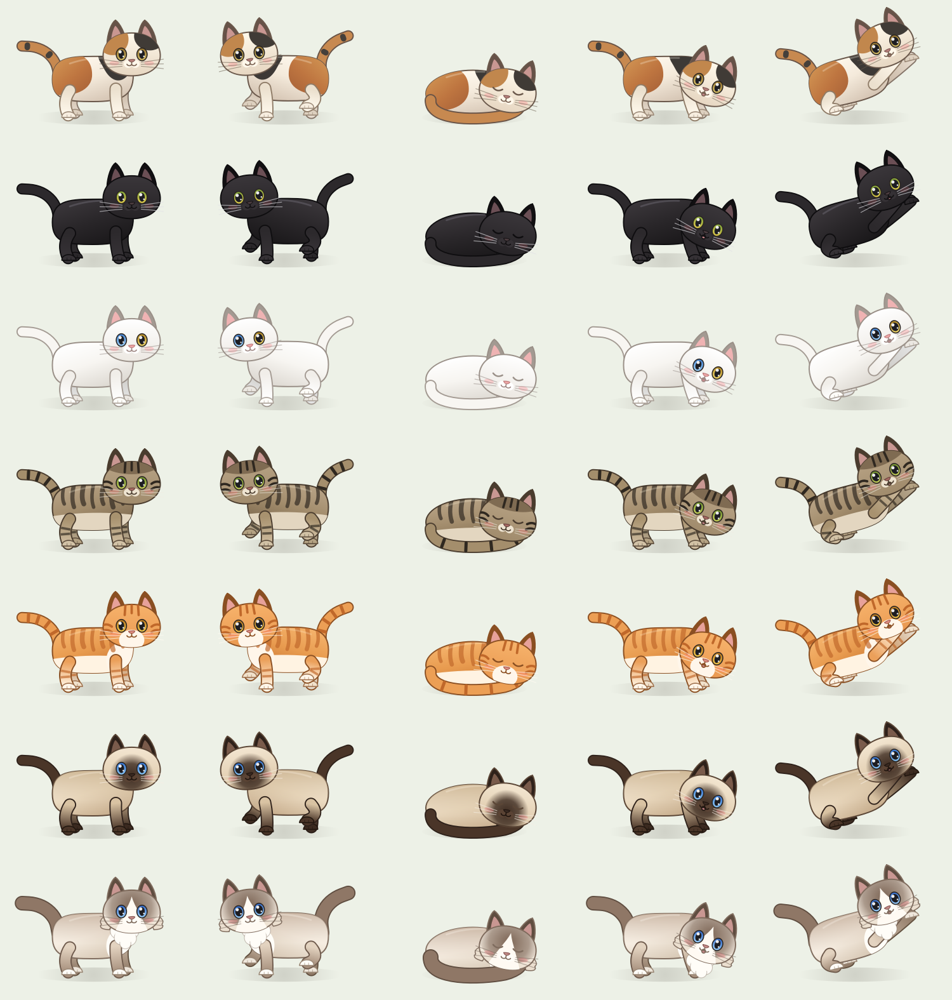
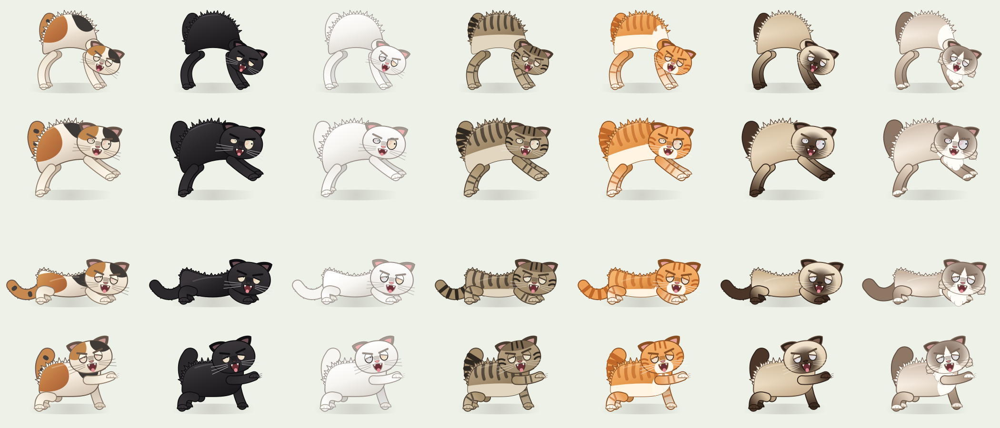

# 🐾 猫猫小院 · Cat Yard

[中文](#中文) · [English](#english)



---

## 中文

一款 Windows 10/11 桌面养猫小程序。七个品种的胖圆小猫在小窗口或桌面上溜达、吃饭、拉屎、睡觉——不同品种的猫一碰面就会炸毛对峙，"老吴老吴老吴老吴"叫个不停。所有猫都是用代码实时绘制的骨骼动画，没有使用图片素材。

### 下载

到 [`release/JianzhouCat.exe`](release/JianzhouCat.exe) 下载，双击运行，不需要安装 Python。建议放在一个单独的文件夹里，存档会写在 exe 旁边。

### 功能

**🐱 七个品种**
三花猫、黑猫、白猫（异瞳）、狸花猫、橘猫、暹罗猫、布偶猫。领养可以随机或指定品种，没有数量上限。主猫品种可以在设置里换。



**😾 应激对峙**
- 不同品种的猫相遇会哈气对峙：互相盯着、炸毛、发抖，头顶冒出"老吴老吴老吴老吴""哦内个内个内个内个..."。
- 随机摆出四种真实的猫咪威吓姿势，并且隔几秒换一种：弓背、侧身横跳、压低伏地、抬爪预备。
- 对峙时循环播放音效，多组猫同时对峙会叠在一起播放；音效可开关、可调音量。
- 用鼠标拖走其中一只、点"拉开"或"劝架"立刻结束；否则至少持续 45 秒（可调），之后随机结束，有时其中一只会撒腿逃跑。
- 对峙时猫会被吓得频繁拉屎。
- 小猫和大猫对峙时，有 50% 概率被大猫一巴掌拍没（只在大猫抬爪拍打时发生），原地留下一座墓碑。



**💩 便便**
吃够次数（或定时）会蹲下拉屎，哪只猫吃的就由哪只拉。便便不清理就永远不会消失，重启也还在，没有上限，可以堆满屏幕。

**😴 睡觉**
鼠标 5 分钟（可调）没动，不在对峙的猫会蜷成一团睡觉，动一下鼠标就醒。

**👶 繁殖与绝育**
同品种的猫相遇可能生小猫。点猫咪卡片上的 ✂、右键菜单或"全部绝育"后就不会再生，绝育的猫一只耳朵尖是平的（就像现实中的 TNR 剪耳）。

**🪶 互动**
- 按住 Ctrl + Alt：鼠标变成羽毛逗猫棒，猫会追逐、扑抱、啃咬。
- 点击猫抚摸，拖动拎起，甩动有惯性；右键猫咪可查看品种、绝育、送养。
- 喂食后猫会跑过去低头吃；还有等级、经验、成就和 CPU 忙碌反应。

**🖥 显示模式**
小窗口里的小院 / 桌面图标层 / 桌面最前面。关闭窗口会收到托盘，双击托盘图标重新打开。

**界面**
顶部是等级、饥饿、便便数、猫数、意见反馈和静音；左边是小院和操作按钮；右边三个标签页：猫咪名册（每只猫的头像和实时状态）、设置、档案（统计和成就）。中英双语。

### 存档

都在 exe 旁边：`settings.json`（设置）、`cat_state.json`（猫咪、便便、墓碑、成长）、`cat_records.json`、`cat.log`。想换对峙音效：在 exe 旁边建 `sounds` 文件夹，放一个 `standoff.wav`。

### 从源码运行 / 打包

需要 Python 3.12 x64：

```powershell
python -m pip install -r requirements-windows.txt
python src/companion.py
.\build-windows.ps1        # 输出 dist/JianzhouCat.exe
python -m pytest -q
```

### 反馈

有想法或发现 bug，欢迎发邮件：**antirezk@gmail.com**（程序顶部的"💌 意见反馈"也可以）。

### 致谢

基于 [sueun-dev/coding-with-kirby](https://github.com/sueun-dev/coding-with-kirby)（MIT 许可，保留原 LICENSE）的养成系统改写。猫咪形象、骨骼动画、品种、对峙、界面等为本项目新增，未使用原项目的 Kirby 图像。

---

## English

A desktop cat game for Windows 10/11. Chubby cats in seven breeds roam a little yard (or your desktop), eat, poop and nap — and when two cats of different breeds meet, they puff up and hiss at each other. Every cat is a code-drawn, skeletal animation; no image assets are used.

### Download

Get [`release/JianzhouCat.exe`](release/JianzhouCat.exe) and double-click it — no Python needed. Put it in its own folder; saves are written next to the exe.

### Features

**🐱 Seven breeds**
Calico, black, white (odd-eyed), Li Hua tabby, orange, Siamese and Ragdoll. Adopt a random or chosen breed, as many as you like. The main cat's breed can be changed in Settings.

**😾 Standoffs**
- Cats of different breeds that bump into each other freeze, stare, bristle and tremble, with speech bubbles like "老吴老吴老吴老吴" and "哦内个内个内个内个...".
- They cycle through four real feline threat displays: the Halloween arch, the sideways crab hop, the low crouch and the raised paw.
- A hissing sound loops for every standoff, and several standoffs overlap; sound can be muted and the volume adjusted.
- Drag one cat away, press Split or Break up to end it. Otherwise a standoff lasts at least 45 s (adjustable), then ends at random — sometimes one cat bolts.
- Scared cats poop a lot.
- When a kitten faces a grown cat there is a 50% chance the adult swats it dead (only during the raised-paw pose); a gravestone appears where it fell.

**💩 Poop**
Cats squat after enough meals (or on a timer); whoever ate is the one who poops. Poop never disappears until you clean it — it survives restarts and has no limit, so it can cover the whole screen.

**😴 Sleep**
If the mouse hasn't moved for 5 minutes (adjustable), every cat that isn't in a standoff curls up into a ball. Move the mouse to wake them.

**👶 Kittens and neutering**
Cats of the same breed may have kittens. Neuter a cat (✂ on its card, the right-click menu, or "Neuter all") and it won't have any more; neutered cats get a flat ear tip, like real TNR cats.

**🪶 Play**
- Hold Ctrl + Alt to turn the pointer into a feather wand — cats chase, pounce and nibble it.
- Click a cat to pet it, drag to carry and fling it; right-click for breed info, neutering and rehoming.
- Feed them, level up, unlock achievements; cats react when your CPU is busy.

**🖥 Display modes**
Inside the app window, on the desktop icon layer, or always on top. Closing the window hides it to the tray; double-click the tray icon to reopen.

**Interface**
The top bar shows level, hunger, poop and cat counts, plus Feedback and mute buttons. The yard and action buttons are on the left; on the right are three tabs: a cat roster (portrait and live status of every cat), Settings, and a Journal with stats and achievements. Chinese and English UI.

### Save files

All next to the exe: `settings.json`, `cat_state.json` (cats, poop, gravestones, progress), `cat_records.json`, `cat.log`. To replace the standoff sound, create a `sounds` folder next to the exe and drop in a `standoff.wav`.

### Run from source / build

Python 3.12 x64:

```powershell
python -m pip install -r requirements-windows.txt
python src/companion.py
.\build-windows.ps1        # produces dist/JianzhouCat.exe
python -m pytest -q
```

### Feedback

Ideas or bugs: **antirezk@gmail.com** (or the "💌 Feedback" button in the app).

### Credits

Built on the pet-raising systems of [sueun-dev/coding-with-kirby](https://github.com/sueun-dev/coding-with-kirby) (MIT; original LICENSE kept). The cats, skeletal animation, breeds, standoffs and interface are new in this project; no Kirby artwork is used.
